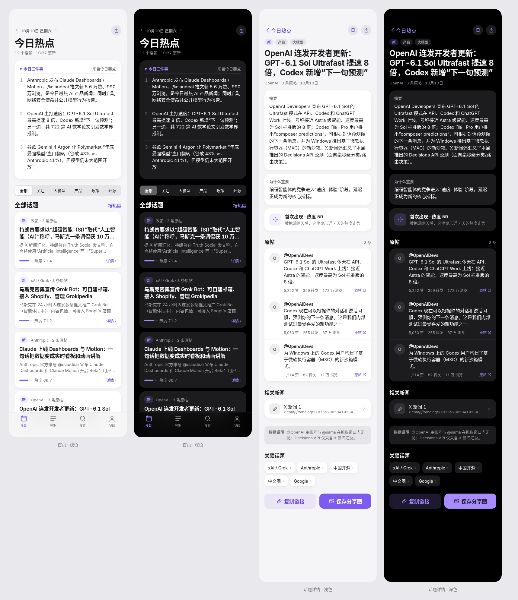
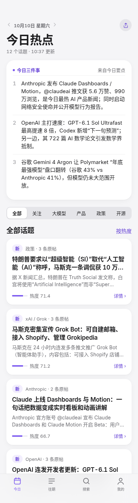
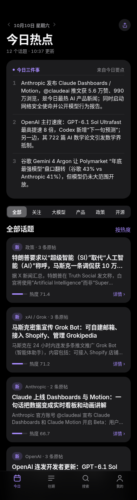
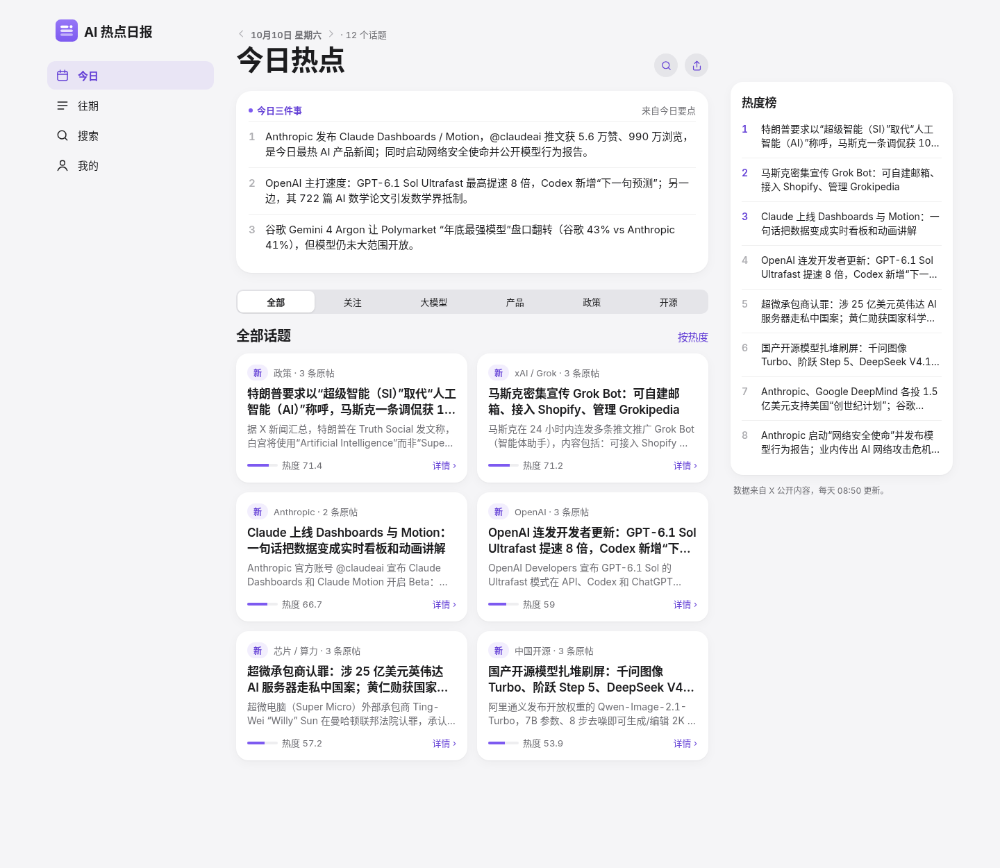
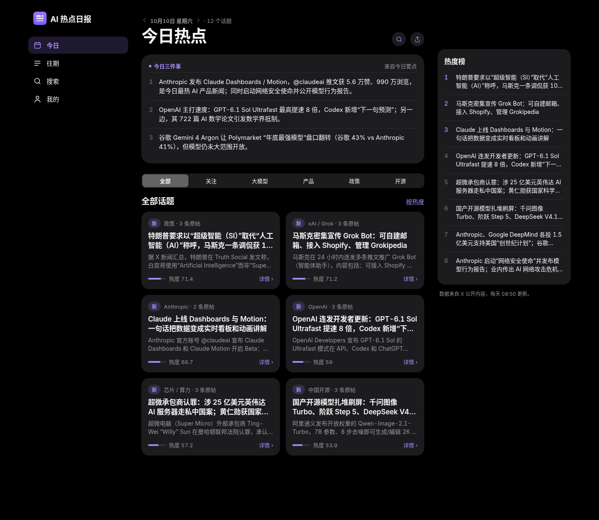
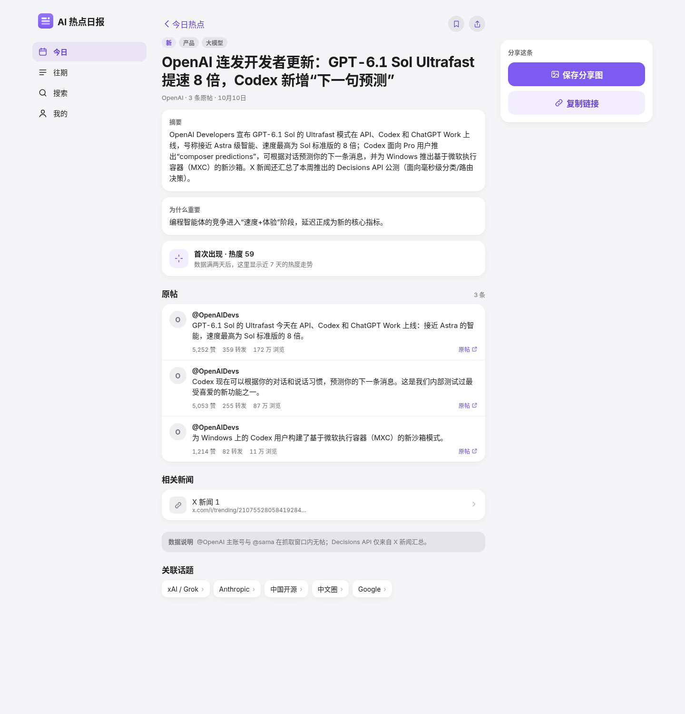
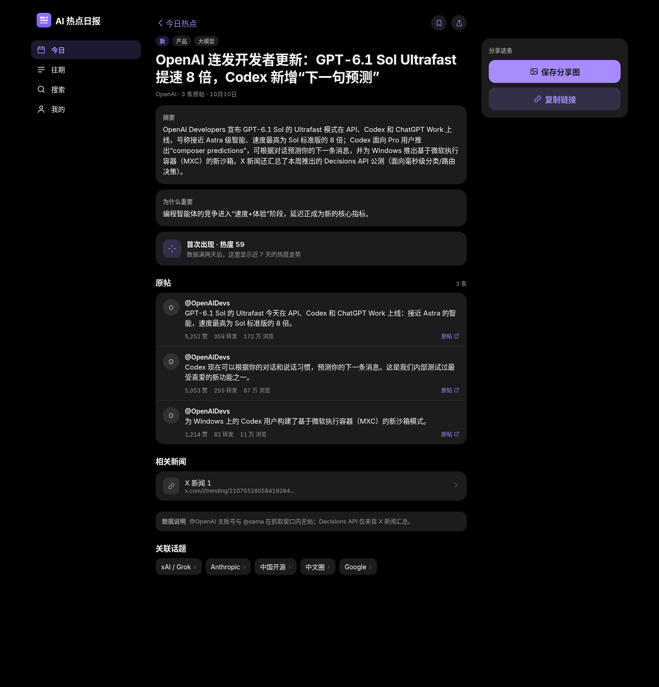
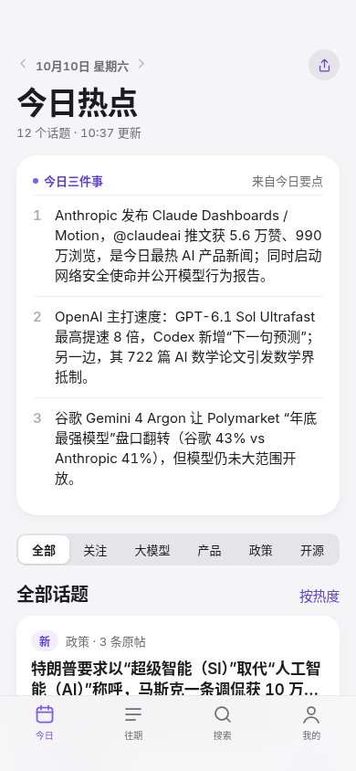

# 高保真稿 v1：首页（F1 #8）与话题详情页（F2 #9）

> 状态：贾维斯已于 2026-10-10 批准。视觉规则以 [视觉规范 v1](visual-spec-v1.md)（PR #5）为准，本文件只说明页面结构、状态和交互。
> 稿子里的内容全部来自真实数据 `data/2026-10-10.json`。源文件是 [`hifi-mockup.html`](hifi-mockup.html)，在仓库根目录起一个静态服务后，按 `?v=home|detail|desk|deskdetail&t=light|dark` 打开即可。

| | 浅色 | 深色 |
|---|---|---|
| 首页 · 手机 390 |  |  |
| 首页 · 桌面 1440 |  |  |
| 详情 · 手机 390 |  |  |
| 详情 · 桌面 1440 |  |  |

手机首屏（390×844）：，能看到完整的三件事和第一张卡片的标题，满足 F1 的验收标准。

## 1. 首页（F1）
从上到下依次是：
1. **日期行**：`‹ 10月10日 星期六 ›`，用 Footnote 字号、600 字重、`text-2` 颜色。左右箭头切换前一天和后一天，没有数据的方向箭头置灰并且不可点；点日期本身进入"往期"。右侧是分享按钮（34px 圆形，`surface-2` 底）。
2. **大标题**："今日热点"，看往期日期时改成"10月9日热点"。下面一行写"N 个话题 · HH:MM 更新"，时间取 `generated_at`。
3. **今日三件事**：大卡片，圆角 22，取 `highlights` 前 3 条，序号用 `text-3`，条目之间用 0.5px 分隔线。不足 3 条时有几条显示几条，为 0 条时整块隐藏。
4. **分类切换**：分段控件，第一项"全部"，第二项"关注"，后面是当天实际出现的分类。手机上放不下时**横向滚动**，不压缩文字。
5. **话题列表**：标题行是"全部话题"，右边是排序方式（默认按热度）。卡片之间留 12。
6. **底部标签栏**（手机端）：今日、往期、搜索、我的，带 80% 不透明底色和模糊，下面避开安全区。

### 话题卡片
- 第一行：状态标签和"机构 · N 条原帖"。状态标签有两种，当天首次出现标"新"（`brand-soft` 底配 `brand-text` 字）；连续出现 N≥2 天标"持续热议 N 天"（`hot` 的 12% 底配 `hot-text` 字）。两者互斥。
- 标题用 Headline，最多两行；摘要用 Subhead 和 `text-2`，最多两行；超出都用省略号。
- 底部：左边是 44×4 的热度条（宽度等于 `heat`%，`brand` 色）加"热度 N"；右边是"详情 ›"。整张卡片都可点，按下时缩到 0.97。

### 桌面端（≥1024px）
- 三栏：左侧 240 放 Logo 和竖向导航（今日、往期、搜索、我的，选中项用 `brand-soft` 底），中间 680 是内容，右侧 320 放热度榜（前 8 条，前 3 名序号用 `brand-text`）。整体居中，栏间距 32。
- 话题卡片排两列；Large Title 放大到 40。
- 1024px 以下切换成手机布局；1024 到 1279px 之间隐藏右侧热度榜。

## 2. 话题详情页（F2）
路径用普通网址（开发工程师正在把 hash 路由换掉），例如 `/story/<id>`。从上到下：
1. **导航行**：左边是"‹ 今日热点"（返回），右边是收藏和分享两个圆形按钮。
2. **标签**：状态标签，加上分类标签（`surface-2` 底配 `text-2` 字）。
3. **标题**：Title 1（手机 26，桌面 30），下面一行是"机构 · N 条原帖 · 日期"。
4. **摘要**、**为什么重要**：各占一张卡片，小标题用 13/600 和 `text-2`，正文用 Body 15/23。
5. **热度走势**：
   - 有 2 天及以上数据时：卡片里显示"热度走势 · 近 7 天"，大字写当天热度和涨跌（上升用 `up-text`，回落用 `text-2`），下面是折线图（规则见视觉规范 §7）。点数和数值必须和数据库一致。
   - 只有 1 天数据时（就是稿子里的状态）：显示一个 40px 的图标块，写"首次出现 · 热度 N"，副文案是"数据满两天后，这里显示近 7 天的热度走势"，**不画图**。
6. **原帖**：列表卡片，每条依次是头像（取账号首字母）、@账号、中文译文（没有译文时显示原文）、赞、转发、浏览（≥1 万时写成"N 万"），以及"原帖 ↗"外链（新窗口打开）。
7. **相关新闻**：`news_refs` 不为空时显示，每条一行，带链接图标；为空时整块隐藏。
8. **数据说明**：`data_quality` 不为空时显示，用 `surface-2` 底的小字条；为空时隐藏。
9. **关联话题**：最多 5 个，规则是同机构或有相同 `topics`，做成可横向换行的小卡片，点进去跳到对应的详情页。
10. **底部操作**：手机上是"复制链接"（次要按钮）和"保存分享图"（主按钮）两个，各占一半；桌面端放在右栏的"分享这条"卡片里。

## 3. 通用状态
- **加载中**：卡片用 `surface-2` 色块做骨架屏，不放转圈。
- **空数据**：当天还没有数据时，三件事和列表的位置换成一句"今天的日报还在路上，08:50 左右更新"，附一个"看昨天"按钮。
- **出错**：显示"加载失败"和"重试"按钮，不显示技术细节。
- 深色模式跟随系统，"我的"里可以手动切换。
