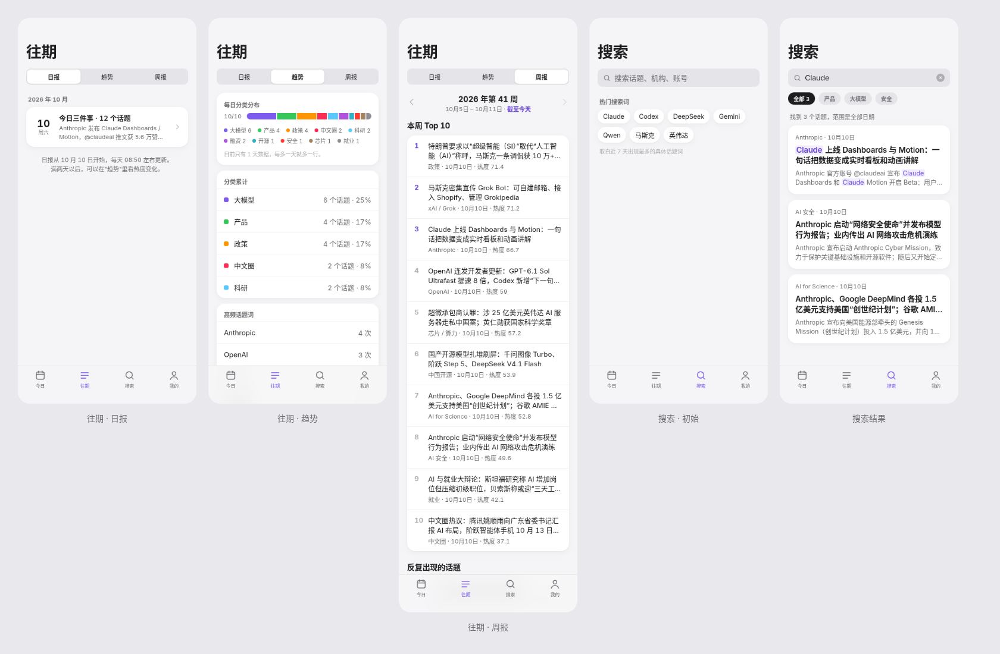
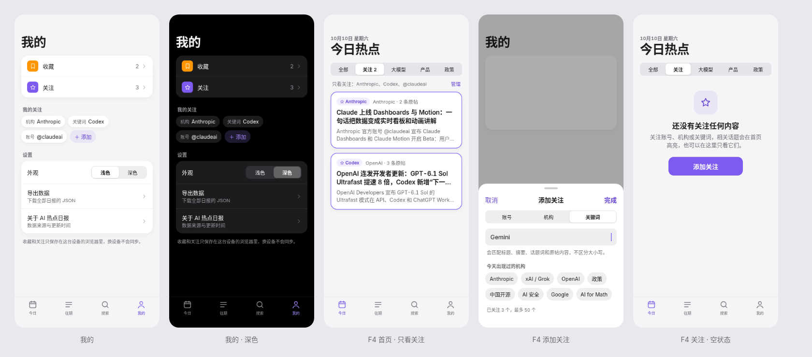
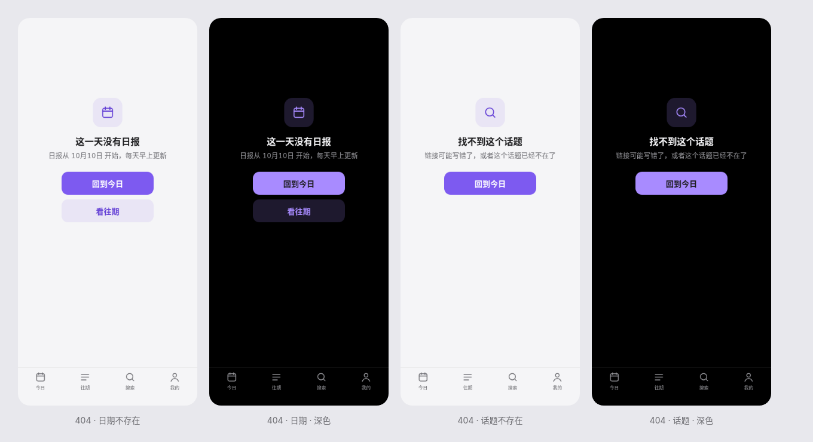

# 往期、搜索、我的 + F4 关注、F5 周报 设计稿 v1

> 关联 Issue #11（F4 关注）、#12（F5 周报），需求以 PRD v6（`docs/product/PRD-v6.md`）为准，视觉以 `visual-spec-v1.md` 和 `tokens.css` 为准。
> 内容来自真实数据 `data/2026-10-10.json`；收藏数和关注项（Anthropic、Codex、@claudeai）是示例。
> 源文件是 [`pages-mockup.html`](pages-mockup.html)，在仓库根目录起静态服务后按 `?v=archive|trend|weekly|searchempty|search|me|follow|addfollow|followempty|nf-day|nf-story&t=light|dark` 打开。日期、星期、周编号都从数据里的 `date` 算出来，mockup 里没有写死。

**说明文字的颜色**：界面里所有说明性的小字（提示、上限、数据说明、序号）一律用 `text-2`，不用 `text-3`，因为 `text-3` 在浅色底上只有 2.0 到 2.8:1。`text-3` 只用于箭头、分隔这类非文字元素。灰底（`surface-2`）上的文字一律用 `text-on-fill`：浅色是 `#636369`（4.79:1），深色是 `#A1A1A6`（放在卡片上的灰底里是 4.96:1，`text-2` 只有 4.45）。底部标签栏和侧边导航的选中态，文字用 `brand-text`（`brand` 在 `#F5F5F7` 上只有 4.2），图标可以继续用 `brand`。

电脑端沿用高保真稿（`hifi-v1.md`）的三栏结构：左侧导航切到对应页，中间放本页内容，最大宽度和首页一致；右侧栏在这几页里不显示。深色模式只换 token，不另出版式。

## 1. 往期 `/archive`

顶部大标题"往期"，下面是分段控件：**日报 / 趋势 / 周报**，分别对应 `/archive`、`?tab=trend`、`?tab=weekly`，切换时改网址，刷新后停在原来的标签。

### 1.1 日报（`archive-mobile-light.png`）
- 按月分组，组标题是"2026 年 10 月"（13px，`text-2`）。
- 每天一行：左边是大号日期（22px/700）和周几，中间第一行写"今日三件事 · N 个话题"，第二行是 `highlights[0]`，最多两行；右边是箭头。点击进入 `/day/YYYY-MM-DD`。
- 只有一天数据时，列表下方放一段灰色说明（见截图），不要伪造更多日期。说明里的"10 月 10 日"和 404 页里的最早日期一样，都要从 `/api/days` 取最早的一天动态生成，不能写死。

### 1.2 趋势（`trend-mobile-light.png`），对应 v5 的趋势功能
- **每日分类分布**：每天一条堆叠条，高 14、圆角 7、段间距 2，日期写在左边。分类色是固定的一组（见 `pages-mockup.html` 里的 `CC`），只在这张图里用，不进入正文的主色体系。图下面放图例，带数量。
- **分类累计**：列表行，左边是色块，右边是"N 个话题 · 占比"。
- **高频话题词**：列表行，右边是次数。展示时要用 PRD 3.1 的黑名单把宽泛词去掉；稿子里为了说明版式，暂时用的是原始计数。
- 数据少于 2 天时，在第一块下面加一行提示"目前只有 1 天数据"。

### 1.3 周报（`weekly-mobile-light.png`），对应 F5
- 周选择器：左右箭头加居中标题"2026 年第 41 周"，副标题"10月5日 – 10月11日"。本周没过完时，在副标题后面加紫色的"**截至今天**"（`brand-text`）；当前周的右箭头置灰。
- **本周 Top 10**：一个白色块，每行是名次（前 3 名用 `brand-text`，其余用 `text-2`）、标题（最多两行）、"机构 · 日期 · 热度"。点击进入 `/story/<id>`。
- **反复出现的话题**：每行是话题词和"N 天"；没有内容时用和详情页"首次出现"相同的空状态卡片，文案是"本周还没有反复出现的话题"。
- 本周完全没有数据时，整页只显示一个空状态卡片：本周还没有日报。
- 底部的"保存周报图"按钮先保留位置，周报分享图不在 v6 范围内，开发可以先不做。

## 2. 搜索 `/search?q=`

- 初始状态（`searchempty-mobile-light.png`）：搜索框（`surface-2`，高 40，圆角 12），占位文字是"搜索话题、机构、账号"，颜色按上面灰底的规则。下面居中一行 `text-2` 说明："搜索全部日期的话题标题、摘要、机构和 X 账号"。（"热门搜索词"这次不做，贾维斯 2026-10-10 定的。）
- 结果状态（`search-mobile-light.png`）：分类筛选做成可横向滚动的 chips，第一个是"全部 N"，用深色实底，其余 chips 是灰底，文字颜色按上面灰底的规则；下面一行灰字写"找到 N 个话题，范围是全部日期"。结果卡片和首页卡片一样，元信息里加上日期，命中的文字用 `mark` 标出（`brand-soft` 底，`brand-text` 字，圆角 4）。
- 没有结果时：搜索框下方居中显示"没有找到和'xxx'相关的话题"，再给一个"清空"按钮。

## 3. 我的 `/me`（`me-mobile-light.png` / `me-mobile-dark.png`）

- 第一组列表是**收藏**和**关注**，左边放 30×30 的圆角图标，收藏用橙色、关注用紫色，右边是数量和箭头。点进去是列表页，收藏页复用搜索结果的卡片样式。
- "**我的关注**"：用 chips 展示，前面用小灰字写类型（机构、关键词、账号），最后一个是紫色的"＋ 添加"。长按或左滑可以删除。
- "**设置**"：外观用分段控件"浅色 / 深色"，默认浅色，不跟随系统，手动切换后记在本机；还有导出数据（v5 功能）和关于。
- 页面底部写明：收藏和关注只存在这台设备的浏览器里，换设备不会同步。

## 4. F4 关注

- **首页筛选**（`follow-mobile-light.png`）：首页分类分段控件的第二项是"关注 N"。选中后，下面一行灰字写"只看关注：A、B、C"，右边的"管理"跳到 `/me`。
- **命中高亮**：在"全部"视图里，命中关注的卡片加一圈 1.5px 的 `brand` 内描边；原来"新"或"持续热议"标签的位置换成紫色胶囊"☆ 命中的关注项"，原来的标签往后挪，不删掉。
- **添加关注**（`addfollow-mobile-light.png`）：从底部弹出，圆角 22，遮罩是 32% 的黑色。顶部是"取消 / 添加关注 / 完成"，下面是"账号 / 机构 / 关键词"三段，再下面是输入框，底下用一行小字说明匹配规则。机构模式下提供"今天出现过的机构"作为快捷选项。底部显示"已关注 N 个，最多 50 个"，到 50 个时"完成"按钮置灰，并用这一行提示上限。
- **空状态**（`followempty-mobile-light.png`）：一个 64×64 的紫色软底星标、标题"还没有关注任何内容"、一句说明，再加一个主按钮"添加关注"。

## 5. 404 页（`overview-404.png`）

日期不存在（`/day/<date>`）和话题不存在（`/story/<id>`）都返回 404 状态码，页面上沿用空状态的版式：64×64 的 `brand-soft` 底图标、20/700 的标题、15px 的 `text-2` 说明，下面是宽 200 的按钮。底部标签栏照常显示，但不高亮任何一项。

| 情况 | 图标 | 标题 | 说明 | 按钮 |
|---|---|---|---|---|
| 日期不存在 | 日历 | 这一天没有日报 | 日报从 {最早日期} 开始，每天早上更新 | 主按钮"回到今日"跳到 `/`；次按钮"看往期"跳到 `/archive` |
| 话题不存在 | 搜索 | 找不到这个话题 | 链接可能写错了，或者这个话题已经不在了 | 主按钮"回到今日"跳到 `/` |

{最早日期} 从 `/api/days` 取最早的一天，格式是"10月10日"，不要写死。404 页的 HTML 里不输出 og 标签。

## 6. 对 hifi-v1 的更正
首页"全部话题"右边的"按热度"去掉，默认按 `rank` 排序（PRD v6 F1），`hifi-mockup.html` 里的卡片顺序也改成了按 `rank`（就是数据里的原始顺序），首页的 5 张基准截图已重新生成。电脑端右侧的"热度榜"仍然按 `heat` 排。`mobile-overview.png` 只是总览拼图，不作为基准，仍是旧版。
