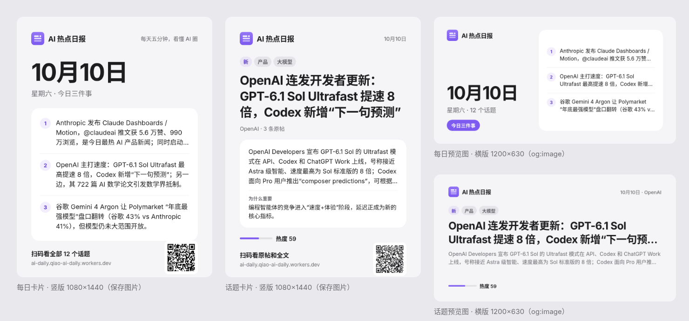

# 分享图设计 v1（F3 #10）

> 状态：贾维斯已于 2026-10-10 确认采用双尺寸方案。视觉规则以 [视觉规范 v1](visual-spec-v1.md) 为准。
> 示意图用的是真实数据 `data/2026-10-10.json`，每日卡片的二维码指向 `/day/<date>`，话题卡片的指向 `/story/<id>`。源文件是 [`share-card-mockup.html`](share-card-mockup.html)，按 `?c=day-v|day-og|story-v|story-og` 打开即可。

## 1. 尺寸与用途
| 图 | 尺寸 | 用途 | 文件名建议 |
|---|---|---|---|
| 每日卡片 · 竖版 | 1080×1440（3:4） | 首页"保存图片" | `share/day/<date>.png` |
| 每日预览图 · 横版 | 1200×630（1.91:1） | 首页和日期页的 `og:image` / `twitter:image` | `og/day/<date>.png` |
| 话题卡片 · 竖版 | 1080×1440 | 详情页"保存分享图" | `share/story/<id>.png` |
| 话题预览图 · 横版 | 1200×630 | `/story/<id>` 的 `og:image` / `twitter:image` | `og/story/<id>.png` |

- 四种图共用一套模板和同一个渲染函数，只是版式参数不同。只做浅色一版。
- `twitter:card` 用 `summary_large_image`。`og:image:width` 和 `og:image:height` 要写成实际尺寸。
- 按 PRD，图片在 `daily.sh` 跑完后由独立脚本预先生成，存进 KV 或 R2，线上不做实时渲染。

## 2. 通用规则
- 底色 `#F5F5F7`，内容卡片 `#FFFFFF`，圆角在竖版上是 44、横版上是 36。分隔线 2px，颜色 `rgba(0,0,0,.06)`。
- 只用纯色、flex 布局、圆角和 `-webkit-line-clamp`（satori 都支持），不用阴影、滤镜、渐变叠加和 grid。唯一的渐变是 Logo 本身，Logo 直接嵌 SVG。
- 字体是思源黑体（Noto Sans SC）加 Inter，按实际用到的字取子集。字重只用 400、500、600、700 四档。
- 颜色：正文 `#1D1D1F`，次要文字 `#6E6E73`，序号和"新"标签用 `rgba(125,90,240,.10)` 底配 `#6440D6` 字，强调块用 `#7D5AF0` 底配白字，热度条用 `#7D5AF0`，热度条底色用 `rgba(118,118,128,.16)`。分类标签是 `rgba(118,118,128,.12)` 灰底，字色要用更深的 `#636369`（4.78:1）；用 `#6E6E73` 只有 4.06:1，不达标。
- 文字超长时一律用省略号截断（行数见下文），不缩小字号。

## 3. 每日卡片 · 竖版 1080×1440
内边距：上 84，左右 80，下 72。从上到下：
1. 品牌行：72px 图标，加"AI 热点日报"（40/700）；右边是"每天五分钟，看懂 AI 圈"（30/500，次要色）。
2. 日期：`10月10日`（132/700，字距 -4px），下面一行"星期六 · 今日三件事"（38/500，次要色）。
3. 三件事卡片：白底，内边距 20/48，每条前面是 60px 的圆形序号，正文 36/54，**最多 3 行**。
4. 底部：左边"扫码看全部 N 个话题"（34/600）和网址（28，次要色）；右边是 184px 的二维码（白底圆角，码指向当天的 `/day/<date>`，过几天再扫旧图也能打开那一天）。

## 4. 每日预览图 · 横版 1200×630
内边距 64，左右两栏，间距 56。
- 左栏宽 400：品牌行（56px 图标，文字 30），日期（88/700，不换行）贴底，下面是"星期六 · N 个话题"（30），再下面是"今日三件事"紫色胶囊（24/600）。
- 右栏：白色卡片，三件事每条前面是 44px 序号，正文 26/38，**最多 2 行**。
- 不放二维码，因为链接预览本来就能点进去。

## 5. 话题卡片 · 竖版 1080×1440
内边距同每日卡片。从上到下：
1. 品牌行，右边写日期。
2. 标签："新"或"持续热议 N 天"（规则同首页），再加分类标签（28px）。
3. 标题：68/88，700 字重，**最多 3 行**；下面一行是"机构 · N 条原帖"（30，次要色）。
4. 白色卡片：摘要 34/54，**最多 4 行**；分隔线下面是"为什么重要"（小标题 26/600，正文 32/48，最多 2 行）。
5. 热度条：180 宽，加"热度 N"（32/600）。
6. 底部：左边"扫码看原帖和全文"加网址，右边是 184px 二维码，指向 `/story/<id>`。

## 6. 话题预览图 · 横版 1200×630
内边距上下 60、左右 72。品牌行（右边写"日期 · 机构"），标签（22px），标题 52/68 **最多 2 行**，摘要 26/40 **最多 2 行**，底部是热度条加"热度 N"。

## 7. 验收要点（给测试）
- 四种图的尺寸严格等于上表。
- 中文不缺字：对当天的全部标题、三件事和摘要文本取子集后渲染，图里不能出现方框或缺字。
- 超长文本按上面写的行数截断，结尾是省略号，不溢出卡片。
- 二维码可以扫开，指向正确的网址。
