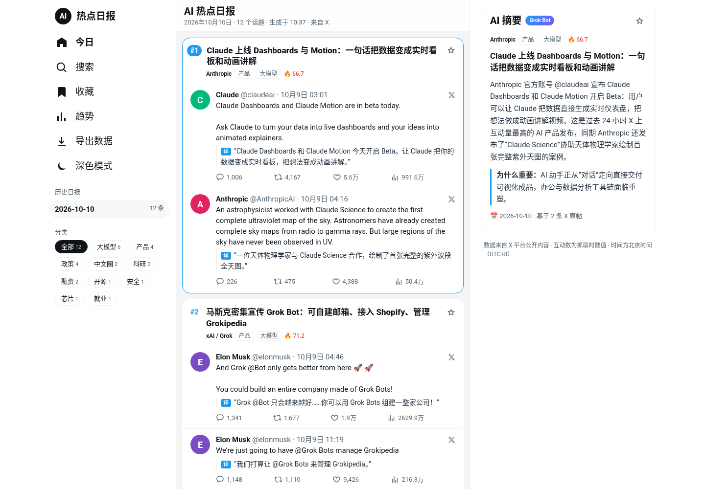
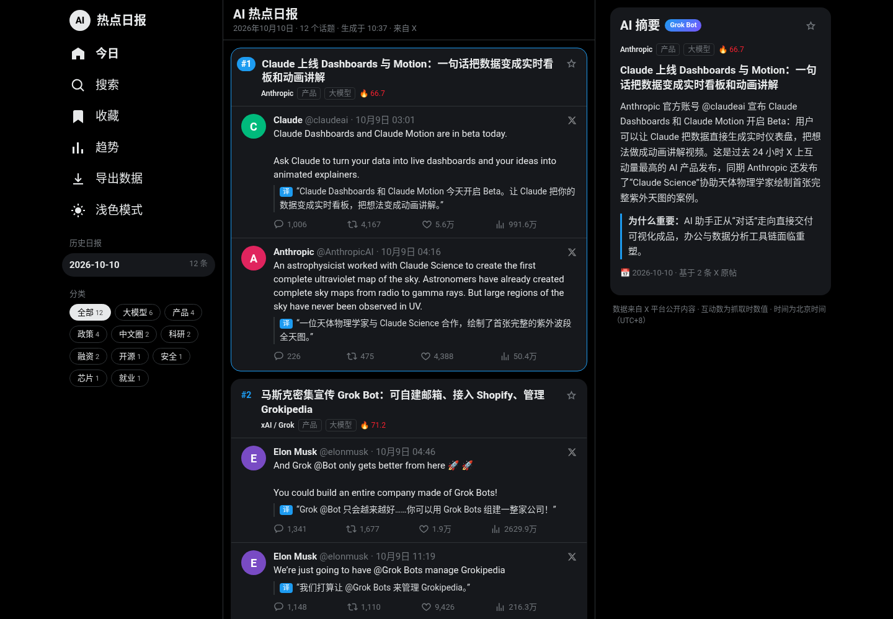
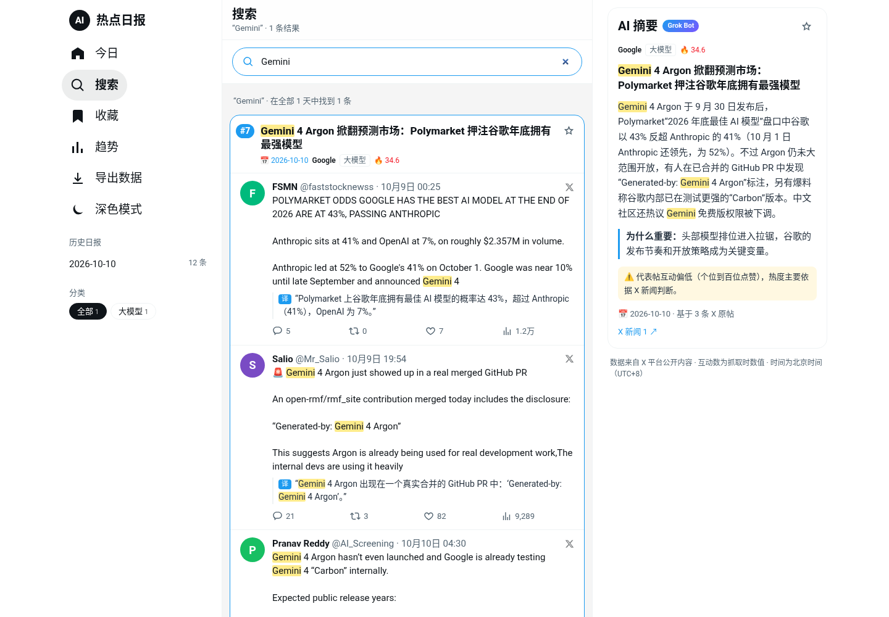

# 设计规范：当前 UI（v5，2026-10-10 上线）

> 新版视觉方向已定为 [视觉规范 v1](visual-spec-v1.md)（苹果风格、紫色主色），本文件在新版上线前继续记录线上 v5 的现状。

截图（线上实拍）：
| 浅色桌面 | 深色桌面 |
|---|---|
|  |  |

| 浅色手机 | 深色手机 | 搜索页 |
|---|---|---|
|  |  |  |

演进：A 方案（X 原生三栏，从 4 个候选中选定）→ v2 浅/深双主题 → v3 卡片化、去掉 Tab/右栏搜索/今日要点、搜索框移到搜索页顶部 → v4 中栏灰底 + 无边框卡片 → v5 选中卡片蓝色边框。

## 1. 布局（X 风格三栏）
| 断点 | 栅格 | 行为 |
|---|---|---|
| ≥1281px | `260px 600px 380px` 居中 | 左：导航 + 历史日报 + 分类；中：话题卡片列表；右：吸顶 AI 摘要 |
| 1001–1280px | `88px 600px 350px` | 左栏只剩图标；中栏顶部出现日期下拉框和横向分类条 |
| ≤1000px | 单栏（最宽 600px） | 隐藏左右栏；顶栏显示工具图标（搜索/收藏/趋势/导出/主题）；AI 摘要卡进入每个话题卡片内、原帖下方 |
| ≤640px | 100% 宽 | 卡片外边距 8px、圆角 14px |

- **左导航**：Logo（黑底圆形 “AI” + “热点日报”），导航项 今日 / 搜索 / 收藏（蓝色数量徽标）/ 趋势 / 导出数据 / 深色模式（切换后文案变“浅色模式”），19px，药丸形 hover。下方“历史日报”（日期 + 条数，选中灰底加粗）、“分类”chips。
- **中栏顶栏**：吸顶、半透明 + 12px 模糊；标题 20px/800（“AI 热点日报”/“搜索”/“收藏”/“趋势”），副标题 13px 灰（日期 · N 个话题 · 生成时间 · 来自 X）。无 Tab（v3 移除）。
- **搜索页**：顶栏下方一条搜索框（圆角药丸，`--input` 底，聚焦时蓝色描边），自动聚焦；其他页面隐藏。
- **右栏**：仅 AI 摘要面板（吸顶，圆角 16px）+ 底部小字数据说明。没有搜索框、没有今日要点（v3 移除）。

## 2. 颜色
| Token | 浅色（默认） | 深色 |
|---|---|---|
| 页面底 `--bg`（左右栏） | `#ffffff` | `#000000` |
| 中栏底 `--mid-bg` | `#f5f5f5` | `#000000` |
| 卡片底 `--card-bg` | `#ffffff` | `#16181c` |
| 主文字 `--fg` | `#0f1419` | `#e7e9ea` |
| 次要文字 `--sub` | `#536471` | `#71767b` |
| 分割线 `--line` | `#eff3f4` | `#2f3336` |
| 强调 `--acc` | `#1d9bf0` | `#1d9bf0` |
| 面板底 `--card`（右栏面板/深色） | 白底 + `#eff3f4` 1px 边 | `#16181c` |
| 输入框 `--input` | `#eff3f4` | `#202327` |
| 热度 | `#f4212e` | `#f4212e` |
| 数据警示 | 字 `#8a6100` / 底 `#fff8e1` | 字 `#ffd400` / 底 `rgba(255,212,0,.08)` |

主题规则：默认浅色，**不跟随系统**；只有用户点了切换才用深色，存 `localStorage['aidaily.theme']`（`"light"`/`"dark"`）。`theme.js` 在 `<head>` 同步执行，避免闪烁。

## 3. 话题卡片（v4/v5）
- 白底（深色 `#16181c`），圆角 16px，卡片间距 12px，**无阴影、无可见边框**。
- 所有卡片都有 `1.5px solid transparent` 边框；**选中卡片**边框变 `#1d9bf0`（只在桌面 >1000px 显示），宽度不变 → 选中时无布局位移。
- **排名药丸**：排名 `#N` 为蓝色粗体；选中卡片的排名变成蓝底白字的药丸。
- 卡片头：`#N` + 标题（17px/800，行高 1.35）+ 右上角收藏星（未收藏描边灰，已收藏实心 `#f5a623`）。
- 元信息行：机构（加粗）、分类小标签（1px 边框 4px 圆角）、🔥热度；搜索/收藏页额外显示 📅 日期。
- 原帖卡片之间用 `--line` 细线分隔。
- 手机：卡片内底部的 AI 摘要块用 `--mid-bg` 底、14px 圆角（标题“AI 摘要”+ Grok Bot 渐变徽标、摘要、为什么重要、数据说明、X 新闻链接）。

## 4. X 原帖卡片
- 整卡是 `<a target="_blank" rel="noopener noreferrer">`，指向 `https://x.com/<handle>/status/<id>`，hover 时浅灰底。
- 40px 圆形头像（显示名首字母，颜色由 handle 哈希取自 10 色板）。
- 头部一行：显示名（700）· @handle · 时间（`10月9日 03:01`，UTC+8，title 中有完整时间）· 右侧 X 图标；超长省略。
- 原文 15px（保留换行）；译文 14px，左侧 2px 竖线 + 蓝底白字 “译” 标签（原文=译文时只显示一份）。
- 互动行：回复 / 转发 / 点赞 / 浏览（≥1 万显示“万”，≥1 亿显示“亿”），hover 时分别变蓝/绿/粉/蓝。

## 5. AI 摘要面板（桌面右栏）
标题“AI 摘要”20px/800 + 渐变徽标（`#1d9bf0 → #7856ff`）+ 收藏星；元信息；话题标题 17px；摘要（行高 1.65）；“为什么重要”带 3px 蓝色左边线；数据说明（黄色提示块）；📅 日期 · 基于 N 条 X 原帖；X 新闻链接。点击中栏任意话题卡片（非原帖、非按钮区域）即切换，键盘 Enter 亦可。

## 6. 字体与排版
系统字体栈：`-apple-system, BlinkMacSystemFont, "Segoe UI", Roboto, "PingFang SC", "Hiragino Sans GB", "Microsoft YaHei", "Noto Sans CJK SC", sans-serif`，正文 15px/1.5。标题 800 字重；次要信息 12–13px。

## 7. 其他视图
- **收藏/搜索**：同样的话题卡片，顶部一行灰字说明（结果数等），分类 chips 基于当前结果。
- **趋势**：3 个无边框卡片区块（每日分类分布堆叠条、分类累计表、话题表），表格可横向滚动。
- 空状态/错误：居中灰字；错误用热度红。

## 8. 约束
- CSP：`script-src 'self'`，不得使用内联 `<script>`；允许内联 style。
- 新 UI 改动需提供 桌面 1440 + 手机 390 × 浅色 + 深色 截图，存 `docs/design/assets/`，并在 Issue 中由负责人选定方案。
