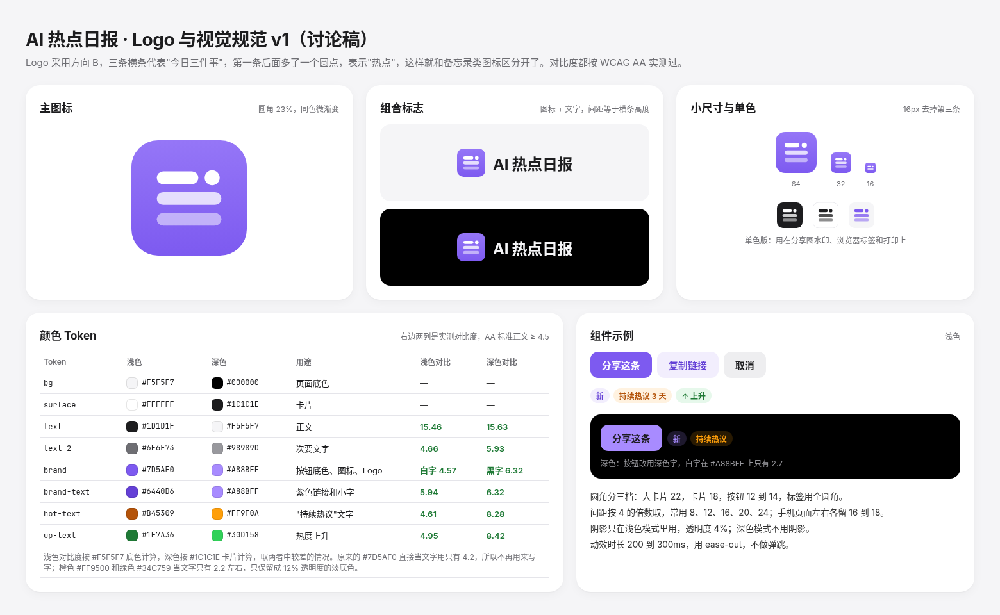
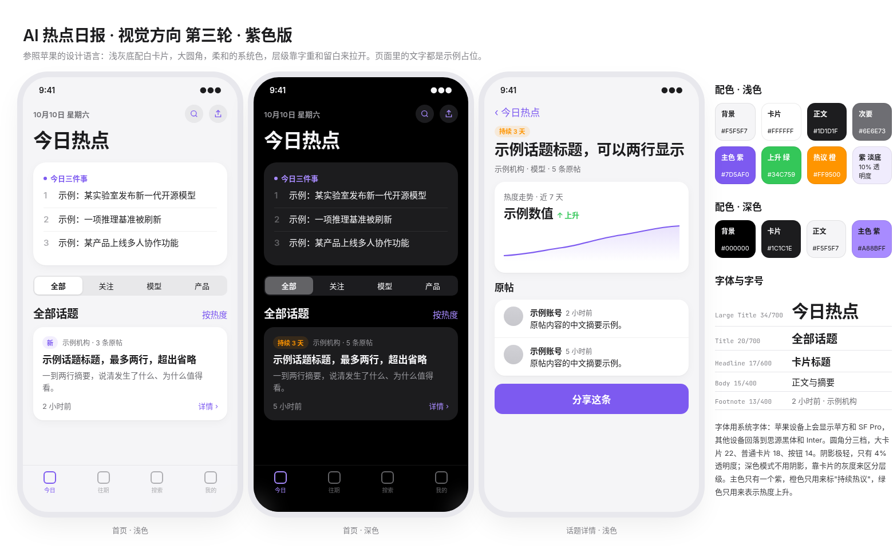

# 视觉规范 v1：苹果风格 · 紫色主色

> 状态：qiao 已于 2026-10-10 在团队群里选定方向（苹果风格、主色紫色、Logo B、底部四个标签），贾维斯已确认 Logo 和本规范 v1。
> 本规范取代 `ui-spec.md` 里 v5 的视觉部分（X 风格、蓝色主色）。新版页面的布局和交互以后续的高保真稿为准；`ui-spec.md` 在新版上线前继续记录线上现状。

> 示意图里的话题、机构和数值都是占位文字，不是真实数据。

## 1. 设计原则
1. **柔和、现代、克制**：浅灰底配白卡片，留白充足，层级主要靠字重、字号和留白来区分，不靠颜色堆叠。
2. **只用一个主色**：紫色只用在主按钮、图标、选中态和 Logo 上。橙色只表示"持续热议"，绿色只表示"热度上升"，三者都不用作装饰。
3. **不要"AI 味"**：不用霓虹发光、紫蓝大渐变、毛玻璃堆叠、星星、机器人、大脑、电路板之类的图形，界面里不放 emoji。
4. **如实呈现数据**：数据不足两天时显示"首次出现"，不硬画走势图。
5. **可访问性**：所有文字至少达到 WCAG AA 标准（正文 4.5:1，大字 3:1），具体数值见第 3 节。

## 2. Logo
概念：三条横条代表"今日三件事"，第一条后面跟一个圆点，表示"热点"。

| 文件 | 用途 |
|---|---|
| `assets/brand/logo-icon.svg` | 主图标（App 图标、PWA、分享图角标、32px 以上） |
| `assets/brand/logo-icon-small.svg` | 小于 24px 时使用（favicon 16/24），去掉第三条，横条加粗 |
| `assets/brand/logo-icon-mono-dark.svg` | 单色深底版（水印、打印） |
| `assets/brand/logo-icon-mono-light.svg` | 单色浅底版 |

- 图标为圆角方块，圆角是边长的 23%；底色是 `#9576F7` 到 `#7D5AF0` 的上下微渐变，这是全站唯一允许使用的渐变。
- 组合标志由图标和"AI 热点日报"组成，文字用 700 字重，字距 -0.3px，图标和文字的间距约等于图标边长的 0.27 倍。
- 图标四周至少保留边长 25% 的安全区。不拉伸、不旋转、不换颜色、不加投影或描边。
- 最小尺寸：主图标 24px，小尺寸版 16px。

## 3. 颜色 Token
对比度实测方法：浅色按 `#F5F5F7` 底色计算，深色按 `#1C1C1E` 卡片计算，两者取较差的情况。

| Token | 浅色 | 深色 | 用途 | 浅色对比度 | 深色对比度 |
|---|---|---|---|---|---|
| `bg` | `#F5F5F7` | `#000000` | 页面底色 | — | — |
| `surface` | `#FFFFFF` | `#1C1C1E` | 卡片、列表 | — | — |
| `surface-2` | `rgba(118,118,128,.12)` | `rgba(118,118,128,.24)` | 分段控件底、次要按钮、图标按钮底 | — | — |
| `separator` | `rgba(0,0,0,.06)` | `rgba(255,255,255,.08)` | 0.5px 分隔线 | — | — |
| `text` | `#1D1D1F` | `#F5F5F7` | 正文、标题 | 15.46 | 15.63 |
| `text-2` | `#6E6E73` | `#98989D` | 次要文字、时间、来源 | 4.66 | 5.93 |
| `text-3` | `#AEAEB2` | `#636366` | 仅用于序号、占位等非关键信息 | 不用于正文 | 不用于正文 |
| `brand` | `#7D5AF0` | `#A88BFF` | 主按钮底色、图标、选中态、Logo | 白字 4.57 | 深色字 `#1C1C1E` 6.32 |
| `brand-text` | `#6440D6` | `#A88BFF` | 紫色文字、链接、"新"标签文字 | 5.94 | 6.32 |
| `brand-soft` | `rgba(125,90,240,.10)` | `rgba(168,139,255,.18)` | 紫色标签底、次要按钮底 | — | — |
| `hot` | `#FF9500` | `#FF9F0A` | "持续热议"图形、标签底（12% 透明度） | 不用于文字 | 8.28 |
| `hot-text` | `#B45309` | `#FF9F0A` | "持续热议"文字 | 4.61 | 8.28 |
| `up` | `#34C759` | `#30D158` | 热度上升的图形 | 不用于文字 | 8.42 |
| `up-text` | `#1F7A36` | `#30D158` | "上升"文字 | 4.95 | 8.42 |

规则：
- `#7D5AF0` 不直接用作浅色底上的文字（在 `#F5F5F7` 上只有 4.2），文字一律用 `brand-text`。
- 深色模式的主按钮用深色字（`#1C1C1E`），白字压在 `#A88BFF` 上只有 2.69。
- 浅色模式的 `#FF9500` 和 `#34C759` 当文字只有 2.2 左右，只用于图形和 12% 透明度的底色。

## 4. 字体
| 场景 | 字体栈 |
|---|---|
| 网页 | `-apple-system, BlinkMacSystemFont, "SF Pro Text", "PingFang SC", "Inter", "Noto Sans SC", "Source Han Sans SC", "Microsoft YaHei", sans-serif` |
| 分享图（服务端生成） | Noto Sans SC（思源黑体）加 Inter，按卡片实际用到的字取子集嵌入，都是 OFL 开源授权 |
| 数字、日期 | 和正文同一字体，开启 `font-variant-numeric: tabular-nums` |

| 级别 | 字号/行高 | 字重 | 字距 | 用途 |
|---|---|---|---|---|
| Large Title | 34/41 | 700 | -0.8px | 页面大标题（今日热点） |
| Title 1 | 26/32 | 700 | -0.5px | 详情页标题 |
| Title 2 | 20/25 | 700 | -0.3px | 分区标题 |
| Headline | 17/23 | 600 | -0.2px | 卡片标题（最多两行） |
| Body | 15/22 | 400 | 0 | 正文、三件事 |
| Subhead | 14/20 | 400 | 0 | 摘要 |
| Footnote | 13/18 | 400–600 | 0 | 来源、时间、小标签 |
| Caption | 11–12/16 | 600 | 0 | 标签、标签栏文字 |

桌面端（≥1024px）的 Large Title 和 Title 1 各放大一级，分别是 40 和 30，其余不变。

## 5. 间距、圆角、阴影
- 间距按 4 的倍数取，常用 4、8、12、16、20、24、32。手机页面左右边距 18，卡片之间 12，卡片内边距 16，分区之间 24。
- 圆角：大卡片（今日三件事、图表）22，普通卡片和列表 18，按钮 12 到 14，分段控件外框 10、内块 8，标签用全圆角，图标 23%。
- 阴影只在浅色模式里用：`0 1px 2px rgba(0,0,0,.04), 0 4px 16px rgba(0,0,0,.04)`。深色模式不用阴影，靠 `surface` 和 `bg` 的灰度差来区分层级。
- 吸顶导航和底部标签栏用 80% 不透明的底色加 20px 背景模糊，下面配 0.5px 的 `separator`。

## 6. 动效
- 时长 200 到 300ms，缓动曲线 `cubic-bezier(.25,.1,.25,1)`，只做淡入、位移和缩放（按下时缩到 0.97）。
- 不做弹跳、闪光和循环动画。系统开启"减少动态效果"时关闭位移动画。

## 7. 组件要点
- **主按钮**：`brand` 底，浅色模式白字、深色模式深色字，高 44 到 50，圆角 14。
- **次要按钮**：`brand-soft` 底配 `brand-text` 字；中性按钮用 `surface-2` 底。
- **标签**：全圆角，12px/600。"新"用 `brand-soft` 底配 `brand-text`；"持续热议 N 天"用 `hot` 的 12% 底配 `hot-text`；"上升"用 `up` 的 12% 底配 `up-text`。
- **分段控件**（全部、关注、分类）：`surface-2` 底，选中块用 `surface` 加轻阴影（深色模式用 `#636366`）。
- **话题卡片**：`surface` 底，圆角 18，内边距 16；从上到下依次是标签和来源、标题（Headline，最多两行）、摘要（Subhead，最多两行）、时间和"详情 ›"。
- **底部标签栏**（手机端）：今日、往期、搜索、我的四个，图标 24px 线性风格，选中项用 `brand` 色。
- **图标**：线性风格，1.75px 描边，圆头圆角，和 SF Symbols 的感觉保持一致。
- **热度走势图**：折线 2px，用 `brand` 色，下面填一层从 18% 到 0 的同色渐变；数据少于两天时不画图，改成显示"首次出现"。

## 8. 分享图
- 只做浅色一版（PRD 已定），竖版 1080×1440，用纯色和 flex 布局，不用阴影和滤镜，方便 satori 渲染。
- 左上角放组合标志，底部放网址，配色和字体严格按本规范来。具体版式在高保真稿里给出。

## 9. 主题切换的实现约定
- 主题由 `<html data-theme="light|dark">` 决定。**第一次打开时默认浅色，不跟随系统**（沿用 v5 的规定，由 qiao 亲自定的）；用户在"我的"里手动切换后记在本机，以后都按用户的选择来。
- `tokens.css` 已经把 Tailwind 的 `dark:` 变体绑定到 `data-theme="dark"`，颜色类和 `shadow-card` 都引用 CSS 变量，切换时不需要重新编译。已用 Tailwind 4 CLI 实际编译验证过。
